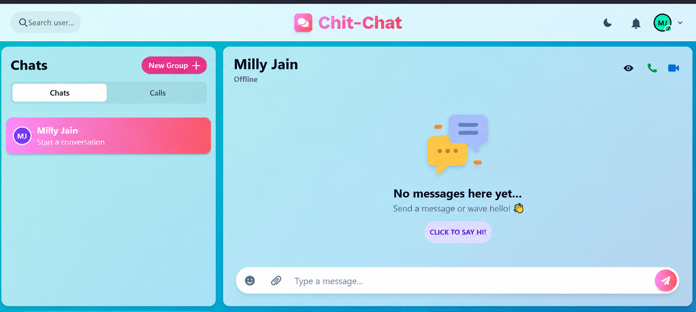
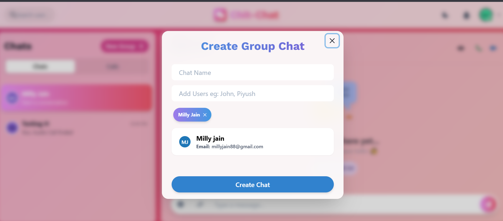
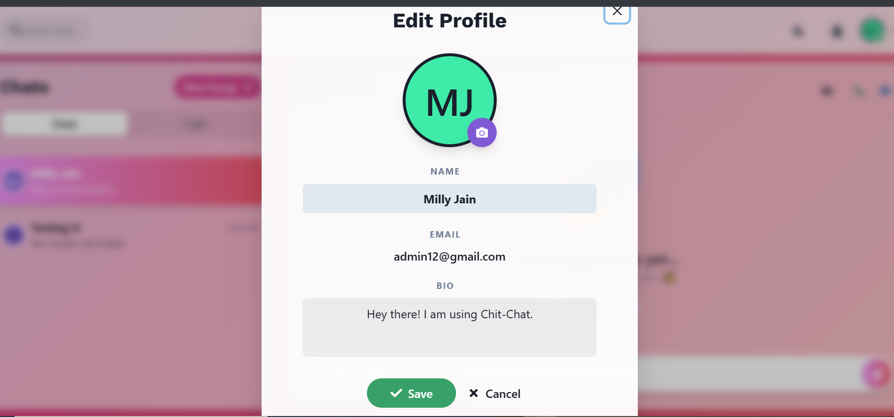

# 💬 ChitChat – A Real-Time Messaging & Video Calling Platform

<p align="center">

  **Connect. Chat. Call. Stay Connected.**

</p>

ChitChat is a full-stack real-time communication platform built using the **MERN Stack**, enabling users to connect through instant messaging, group conversations, and audio and video calls.

It combines real-time communication, secure authentication, media sharing, and an interactive user interface to deliver a seamless messaging experience across devices.

---

## ✨ Key Features

- **🔐 Secure Authentication:** User registration, login, and logout with JWT and bcrypt-based password security.
- **⚡ Real-Time Messaging:** Instant text communication powered by Socket.io.
- **⌨️ Typing Indicators:** See when another user is typing in real time.
- **📞 Audio & Video Calls:** Peer-to-peer communication using WebRTC.
- **👥 Group Chats:** Create groups and communicate with multiple users.
- **😊 Emoji Support:** Express yourself using an integrated emoji picker.
- **📁 Media Sharing:** Send and receive images or files seamlessly.
- **🔔 Real-Time Notifications:** Get notified about incoming messages and calls.
- **📱 Responsive Design:** Optimized for desktop, tablet, and mobile devices.
- **🎨 Smooth UI Animations:** Enhanced user experience using Framer Motion.

---

## 📸 Project Screenshots

### 💬 Main Chat Interface

<p align="center">
  
</p>

### 👥 Group Chat

<p align="center">
  
</p>

### 👤 User Profile

<p align="center">
  
</p>

---

## 🛠️ Tech Stack

| Category | Technologies |
|---|---|
| Frontend | React.js, Tailwind CSS |
| Animations | Framer Motion |
| Icons | Lucide React |
| Backend | Node.js, Express.js |
| Database | MongoDB |
| Real-Time Messaging | Socket.io |
| Audio & Video Calls | WebRTC |
| Authentication | JWT, bcrypt |
| Media Storage | Cloudinary |

---

## 📋 Prerequisites

Before running the project, make sure you have:

- Node.js (v16 or above)
- npm or yarn
- MongoDB Atlas account or local MongoDB installation
- Cloudinary account

---

## ⚙️ Installation & Setup

Follow these steps to run ChitChat locally.

### 1. Clone the Repository

```bash
git clone https://github.com/millyjain09/chitchat.git
cd chitchat
```

### 2. Install Dependencies

Open a terminal in the project directory.

**Backend:**

```bash
cd backend
npm install
```

**Frontend:**

Open another terminal from the project root directory:

```bash
cd frontend
npm install
```

### 3. Configure Environment Variables

Create a `.env` file inside the `backend` directory and add the following:

```env
PORT=5000

MONGODB_URI=your_mongodb_connection_string

JWT_SECRET=your_secret_key

CLOUDINARY_CLOUD_NAME=your_cloud_name
CLOUDINARY_API_KEY=your_api_key
CLOUDINARY_API_SECRET=your_api_secret
```

Replace the placeholder values with your actual configuration.

**Note:** Never commit your `.env` file or expose sensitive credentials on GitHub.

### 4. Run the Application

Start the backend server:

```bash
cd backend
npm run dev
```

Start the frontend in a separate terminal:

```bash
cd frontend
npm run dev
```

Open the local URL displayed by the frontend development server to access ChitChat.

---

## 🎯 Project Objectives

- Build a seamless real-time messaging experience.
- Enable secure and reliable user authentication.
- Integrate peer-to-peer audio and video communication.
- Support interactive group conversations and media sharing.
- Deliver a responsive and engaging communication interface.

---

## 🔮 Future Enhancements

- Message editing and deletion.
- Read receipts and message delivery status.
- Message reactions and reply functionality.
- Enhanced group management.
- Improved call history and notification management.

---

## 👩‍💻 Author

**Milly Jain**

B.Tech Computer Science & Engineering

- GitHub: [millyjain09](https://github.com/millyjain09)
- LinkedIn: [Milly Jain](https://linkedin.com/in/milly-jain/)

---

<p align="center">

  **Built with ❤️ to make communication seamless.**

  *Chat. Connect. Communicate.*

</p>
